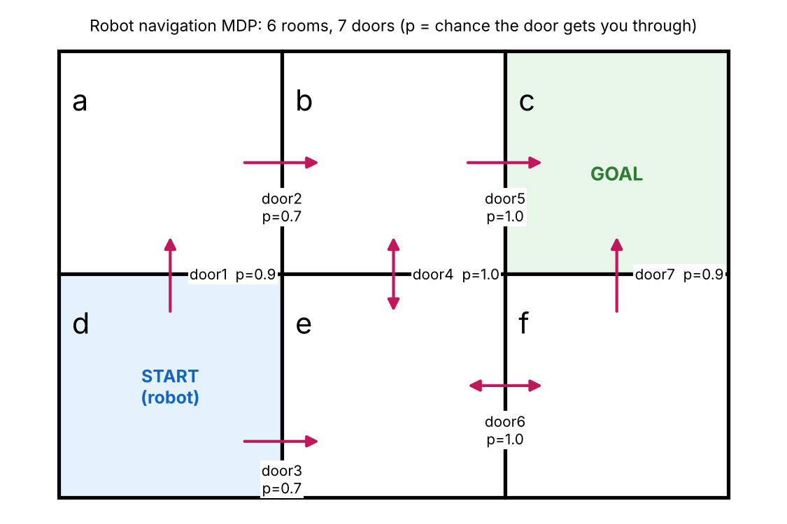
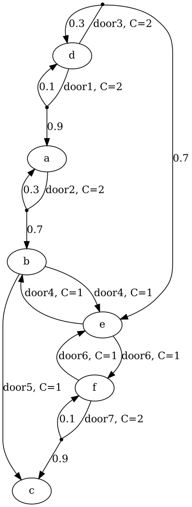

# Robot Navigation with a Markov Decision Process

A lab from the **OxNet Access Programme** (University of Oxford), 2025.

A robot starts in room **d** and has to reach the goal room **c**. The six rooms are linked by seven doors, and some doors are unreliable: going through them only works with a certain probability, otherwise the robot stays put. Every attempt has a cost.

**Goal:** find the door to try in each room so that the *expected* total cost of reaching the goal is as low as possible.



## Approach

- Modelled the problem as a **Markov Decision Process (MDP)**: 6 states (rooms), 7 actions (doors), a transition-probability matrix for each door, and a cost matrix.
- Represented everything with **NumPy** matrices so one value-iteration step is a single matrix operation:
  `Q = T · v + C`, then `v = min(Q)` over actions.
- Ran **value iteration** until the largest change in any state's value was below 10⁻⁵ (17 iterations), then read off the optimal policy with `argmin`.
- Visualised the MDP with **Graphviz** to check the model was set up correctly.



## Result

| Room | Best door | Expected cost to goal |
|------|-----------|-----------------------|
| d (start) | door 3 | 4.86 |
| a | door 2 | 3.86 |
| e | door 4 | 2.00 |
| f | door 7 | 2.22 |
| b | door 5 | 1.00 |
| c (goal) | n/a | 0 |

**Optimal route from d:** d → door 3 → e → door 4 → b → door 5 → c (expected cost ≈ 4.86)

The route through room a looks just as short, but it passes through **two** unreliable doors (expected cost ≈ 6.08), so the robot is better off going via e, which has only one.

## What I learned

- How to model decision-making under uncertainty as an MDP (states, actions, transition probabilities and costs)
- How to represent an MDP with NumPy matrices and use vectorised operations
- How value iteration and the Bellman update find an optimal policy, and why expected cost matters more than the number of steps

## Run it

```bash
pip install numpy graphviz jupyter
jupyter notebook robot_navigation_mdp.ipynb
```

(The Graphviz visualisation also needs the Graphviz system package: https://graphviz.org/download/)

## Credits

The room layout and the notebook's helper functions were provided by OxNet as a starter template. Building the room/door model in code, solving it and the analysis are my own work.
